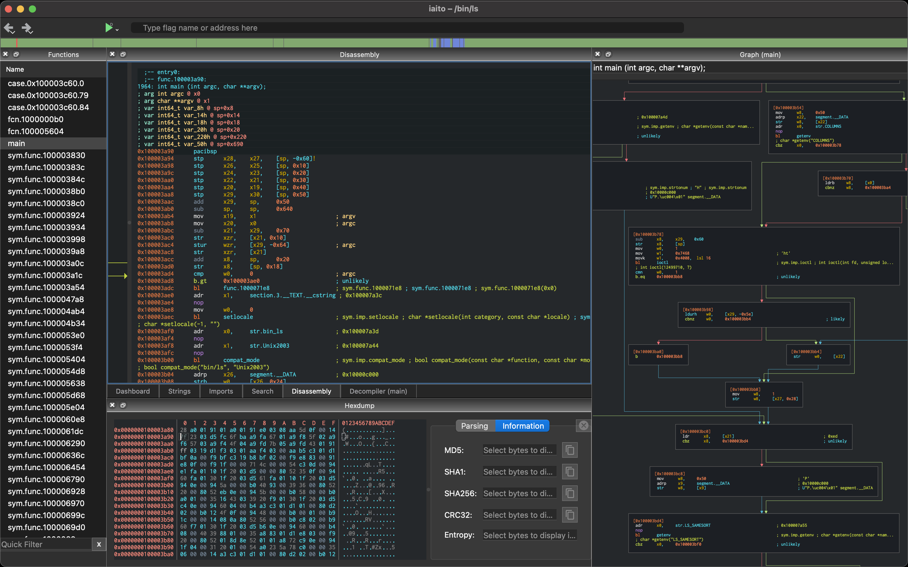

# iaito: use radare2 with one hand!

iaito is the official graphical interface for radare2, a libre reverse engineering framework.


* Based on radare2 and Qt-5/6
* Iaito was the original name before being forked as Cutter.
* Use all your favourite r2 plugins and scripts (nothing is specific to iaito)
* Focus on simplicity, parity with commands, features, keybindings
* Forensics, bindiffing, binary patching, .. not just a static disassembler

[](https://crowdin.com/project/iaito)
[](https://github.com/radareorg/iaito/actions)



## Help

For touchscreens, select **Tablet** in **Settings → Appearance → Interface Theme**.
This Adwaita-inspired light theme provides large controls and list rows, swipe scrolling with
momentum and edge bounce, and long-press context menus. Disassembly, hex and graph views also
support swipe navigation. Switching to another interface theme restores desktop controls.

Get help, updates, meet the community or discuss about development in these channels:

- **Discord:** [https://radare.org/discord](https://radare.org/discord)
- **Telegram:** https://t.me/radare
- **Mastodon:** [@radareorg](https://infosec.exchange/@radareorg)
- **Translations:** [crowdin](https://crowdin.com/project/iaito)!


## Installation

There are automated CI builds and [releases](https://github.com/radareorg/iaito/releases) of iaito for Linux, macOS and Windows.

On WSL or Linux you can use these steps to install it with Flatpak:

```sh
sudo flatpak remote-add flathub https://dl.flathub.org/repo/flathub.flatpakrepo
sudo flatpak install flathub org.radare.iaito
flatpak run org.radare.iaito
```

On macOS, you may want to fix the signature

```sh
sudo xattr -c /Applications/iaito.app
sudo codesign --force --deep --sign - /Applications/iaito.app
```

<a href='https://flathub.org/apps/details/org.radare.iaito'></a>

## Source Builds

### Dependencies

iaito requires [radare2](https://github.com/radareorg/radare2) and qt5 (or qt6):

```sh
$ git clone https://github.com/radareorg/radare2 && radare2/sys/install.sh
```

Install QT on macOS like this:

```sh
brew install qt@5
echo 'export PATH="/opt/homebrew/opt/qt@5/bin:$PATH"' >> ~/.profile
```

On Ubuntu/Debian

```sh
sudo apt install qttools5-dev qttools5-dev-tools qtbase5-dev qtchooser qt5-qmake qtbase5-dev-tools libqt5svg5-dev make pkg-config build-essential
```

For QT6:

```sh
sudo apt install qt6-svg-dev
```

### Compilation

```sh
./configure
make
make run
```

On macOS, `make run` launches the app from `build/iaito.app` without installing it.
Registering the `iaito://` URI handler is optional; see [deep links](doc/deeplinks.md#macos).

To install the app in your home:

```sh
make install
```

### iOS: iPhone and iPad (experimental)

On macOS with full Xcode, Python 3, Meson and Ninja installed, run
`./scripts/ios.sh`. It downloads Qt 6 for iOS and its matching Mac tools,
builds current radare2 as static device/simulator libraries, generates
`dist/ipad/iaito.xcodeproj`, and builds an unsigned universal iPhone/iPad app.
Pass a radare2 tag or commit to pin its version. Open the generated project to
select your signing team and run on an attached iPhone or iPad. `--archive` and
`--export` support signed distribution builds. See [the iOS build guide](dist/ipad/README.md)
for signing, simulator support, dependency artifacts and options.

### Android tablets (experimental)

`scripts/android.sh` builds a standalone `iaito-VERSION.apk` in the repository root.
It uses Meson to cross-compile radare2 and Qt's qmake/Gradle deployment to build
iaito and package Qt, the radare2 libraries, and the radare2 runtime databases.
The package ID is `org.radare.iaito`. The APK is debug signed for sideloading;
store release signing is not configured.

Install a Qt 6 Android kit with Qt SVG and its matching desktop host tools,
the Android SDK platform and build-tools required by that Qt release, its
recommended NDK and JDK, plus Meson >= 0.63, Ninja, make, Python 3, pkg-config
and a host C compiler. For example, with an existing Qt installation:

```sh
export QT_ANDROID="$HOME/Qt/6.10.3/android_arm64_v8a"
export ANDROID_SDK_ROOT="$HOME/Android/Sdk"
export ANDROID_NDK_ROOT="$ANDROID_SDK_ROOT/ndk/27.2.12479018"
./scripts/android.sh --check
./scripts/android.sh
adb install -r iaito-6.2.6.apk
```

The default ABI is `arm64-v8a`, minimum API is 28, and compilation uses at most
eight jobs. `ANDROID_ABI`, `ANDROID_MIN_SDK`, `ANDROID_TARGET_SDK`, `BUILD_DIR`,
`APK_OUTPUT` and `JOBS` can override these defaults. Use a fresh build directory
when changing the NDK, ABI or radare2 revision. Build logs are kept under
`build-android/ABI/`.

The script fetches current radare2 from GitHub, including its Android `content://`
plugin. Set `R2_REPOSITORY` and `R2_REF` to select a different repository or revision
with `RIOContent` support. The snapshot is cached on first use; use a fresh
`BUILD_DIR` to update an older snapshot. Local uncommitted changes are not included.
Radare2's dependencies and Gradle packages
may require network access. Neither the desktop build nor the original radare2
checkout is reconfigured. A small adjustment in the build copy compiles the SDB
database generator for the build machine. `--r2-only` builds and stages radare2
without requiring Qt or the Java SDK.

Android and iOS use one touch toolbar. **Menu** contains the same commands as the
desktop menubar; **Menu → View → Go to address…** opens address entry. **Panels**
opens a searchable grid of panels. Wide landscape tablets also show a sidebar;
its selector switches between Functions, Symbols, Imports and other panels.
In portrait, **Browse** toggles the selected sidebar panel at full width. Swiping
right from the left edge opens it too. Swipe the tab strip to change tabs, and
pinch disassembly, hexdump or decompiler text to change its size. Floating dialogs
have a title and a close button. The status bar and navigation overview are hidden
by default and can be enabled under **Menu → Window → Toolbars**.
**Menu → File → Open** opens another file in the current mobile session.
Mobile layouts are saved separately from desktop layouts. To preview this UI
with a desktop build, run `IAITO_MOBILE_UI=1 make run`.

The native Android picker opens documents through `content://` using the app's
ContentResolver and retains read permission for Recent Files. The IO selector
follows the selected URI's scheme; encoded document IDs reach r2 unchanged.
Read-only streams are cached in app-private storage for random access.
Native debugging is disabled. Exporting projects, launching additional sessions,
and tablet interaction still need platform work and device testing.

### Building iaito as an r2 plugin

It is also possible to launch iaito from the r2 shell reusing the Core instance:

```
make plugin
```

The previous command will build iaito, the iaito plugin and copy it it into your home plugin directory.

```
$ r2 /bin/ls
> iaito
...
```

### Translations (Optional)

Note: The flatpak/flathub version already ships the translations as an optional extension.

To install translations please download latest version from [iaito-translations](https://github.com/radareorg/iaito-translations) repo.

To install in your home directory, run the following:

```sh
$ git clone https://github.com/radareorg/iaito-translations.git
$ cd iaito-translations
$ make user-install
```

Alternatively, it this project makefile can be used to install them:

```sh
$ make user-install-translations
OR
$ make install-translations # to install to system
```

### Binaries

Most distros may Checkout the [Releases](https://github.com/radareorg/iaito/releases) page to download the build for Linux, macOS or Windows, and read the notes in case of problems!

As shown below, most distros are packaging iaito already, pick the build you like the most!

[](https://repology.org/project/iaito/versions)

Snap:

[](https://snapcraft.io/iaito)
